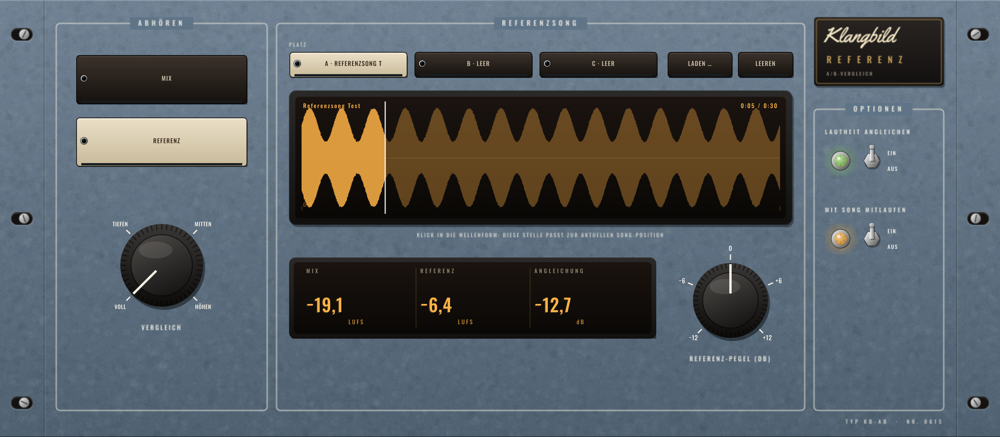

# Klangbild Referenz

A/B-Vergleich mit Referenzsongs im Rack-Look: Lade bis zu drei Lieblingssongs, schalte per Knopfdruck
zwischen deinem Mix und der Referenz um – **automatisch auf gleiche Lautheit gebracht**, damit „lauter“
nicht „besser“ vortäuscht. Audio Unit für Logic Pro (außerdem VST3 und Standalone), gebaut mit [JUCE](https://juce.com).



## Bedienung

| Bereich | Funktion |
|---|---|
| **MIX / REFERENZ** | umschalten (knackfrei überblendet) – auch automatisierbar |
| **Platz A / B / C** | drei Referenzsongs; **LADEN …** lädt WAV, AIFF, MP3, M4A, FLAC oder CAF in den gewählten Platz, **LEEREN** entfernt ihn |
| **Wellenform** | zeigt den Song und die Abspielposition. **Klick** = diese Stelle passt zur aktuellen Song-Position (z. B. Refrain auf Refrain legen) |
| **Vergleich** | Voll · Tiefen (< 150 Hz) · Mitten · Höhen (> 5 kHz) – gilt für Mix und Referenz gleichermaßen |
| **Referenz-Pegel** | Feinkorrektur ±12 dB zusätzlich zur Angleichung |
| **Lautheit angleichen** | Referenz wird auf die gemessene Lautheit deines Mixes gebracht (LUFS nach BS.1770) |
| **Mit Song mitlaufen** | Referenz läuft synchron zur Logic-Position mit (Start, Stopp, Springen); aus = läuft frei weiter |

Die Anzeige zeigt die Lautheit des Mixes (ab Songanfang gemessen), die Lautheit der Referenz (ganzer Song) und
die angewendete Angleichung.

## So benutzt du es
1. **Als letztes Plugin** auf den Stereo-Out setzen (hinter Limit/Lautheit).
2. Referenz laden – ein professionell gemischter Song im gleichen Stil.
3. In der Wellenform auf die passende Stelle klicken, Logic abspielen, mit **MIX/REFERENZ** hin und her schalten.
4. Mit **Vergleich → Tiefen/Höhen** gezielt hören: Ist mein Bass so fett? Meine Höhen so offen?
5. **Vor dem Export auf MIX stellen** (oder das Plugin deaktivieren).

Die Referenz-Dateien werden mit dem Projekt gemerkt (Pfad) und beim Öffnen wieder geladen.

## Messwerte
| Test | Ergebnis |
|---|---|
| Referenz −6,4 LUFS, Mix −19,6 LUFS → angeglichen | −19,56 LUFS |
| MIX hören | bitgenau unverändert |
| Startpunkt / Mitlaufen mit Song-Position | sample-genau (Übereinstimmung 1,0000) |
| Datei 44,1 kHz im 48-kHz-Projekt | wird automatisch umgerechnet |

## Installation in Logic Pro

Tab **Actions** → letzter grüner Lauf → **Artifacts** → `Klangbild-Referenz-macOS`, dann:

1. `Klangbild-Referenz-AU.zip` entpacken → `Klangbild Referenz.component`
2. Finder → ⇧⌘G → `~/Library/Audio/Plug-Ins/Components` → Datei hineinkopieren
3. Einmal im Terminal:
   ```
   xattr -dr com.apple.quarantine ~/Library/Audio/Plug-Ins/Components/"Klangbild Referenz.component"
   ```
4. Logic starten: **Audio Units → Klangbild → Klangbild Referenz** (nur auf Stereo-Spuren/-Bussen)

## Lizenzen

Schriften *Oswald* (OFL 1.1) und *Yellowtail* (Apache 2.0) – Lizenztexte in `Resources/`.
JUCE: AGPLv3 bzw. kommerziell – für den privaten Gebrauch unproblematisch.
